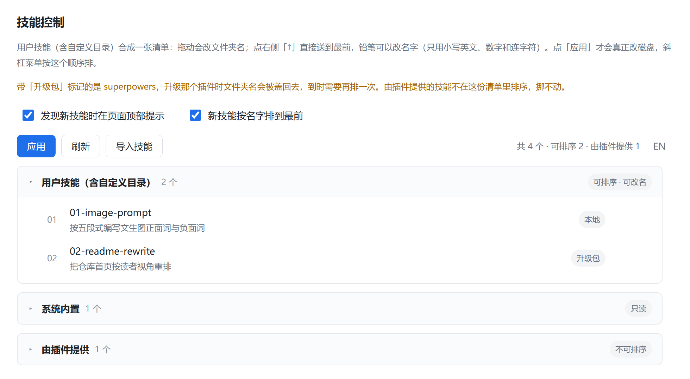
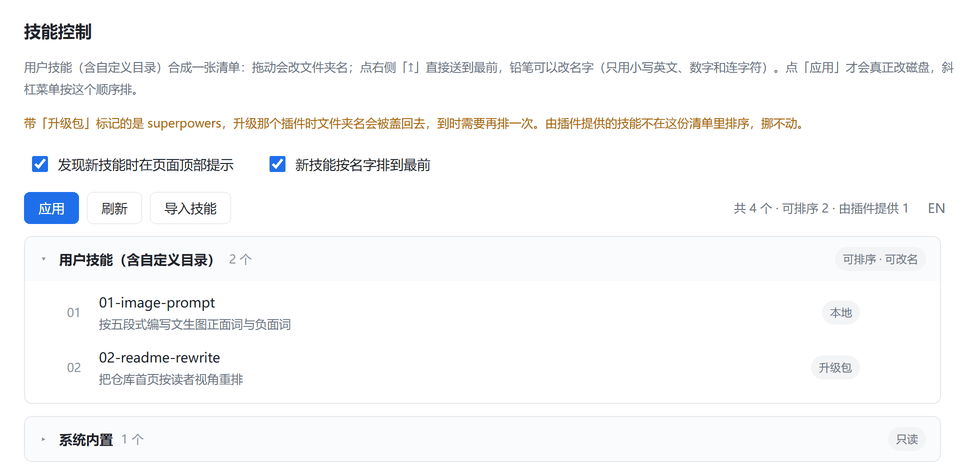

<h1 align="center">dsh-skill-order</h1>

<p align="center">也叫「技能管家」——同一个插件，搜索任一名字都能找到。</p>

<p align="center"><a href="README.en.md">English</a></p>

<p align="center">
  <a href="#装">装</a> ·
  <a href="#为什么需要它">为什么需要它</a> ·
  <a href="#能做什么">能做什么</a> ·
  <a href="docs/DEVELOPMENT.md">开发</a>
</p>

<p align="center">
  <b>DSH 技能控制（别名「技能管家」）：分组排序、行内改名、一键导入，改完斜杠菜单立刻生效。</b>
</p>

<p align="center">
  
</p>
<p align="center">
  
</p>
<p align="center"><sub>拖动排序 → 点「应用」：目录名与编号一起改，斜杠菜单当场跟过来。</sub></p>

<p align="center">
  <a href="https://github.com/yjnmedia/dsh-skill-order/releases"></a>
  <a href="LICENSE"></a>
  
  
</p>

## 装

**一、从市场装。** 在 DSH 的插件市场里添加索引：

```
https://raw.githubusercontent.com/yjnmedia/dsh-skill-order/main/market-index.json
```

**二、一条命令装。** 把 `<profile>` 换成你实际在用的配置名（桌面版是 `desktop`，网页版是 `web`）：

```sh
dsh plugin --profile <profile> add github:yjnmedia/dsh-skill-order
```

装完看**左栏**：菜单里会多一项 **技能控制**（紧挨着「技能中心」）。没有这一项，说明插件没加载，见 [排障](docs/DEVELOPMENT.md#插件没加载)。

## 为什么需要它

DSH 的斜杠菜单只按技能名的字符编码排，没有排序配置项；也没有界面能改名、看简介长短、发现库里悄悄多出来的技能。

技能一多就乱：名字不规范，`/` 里调不出；简介太长，菜单里被截断；顺序不对，常用的压在最后。改一处，只能手工翻文件夹、再重启。

## 能做什么

**排** 拖动调整顺序，行末 ↑ 一键置顶。点「应用」才落盘，目录名和 `SKILL.md` 一起改，失败回滚。

**改** 行内铅笔只换词干，编号按位置自动重排；简介超过 20 个汉字标黄，应用前提醒一次。

**收** 后台每 2 秒看一次技能目录：新技能自动补编号、洗净名字、把过长简介调模型改到 20 字内，顶到最前并提示，直到你点「应用」。

**通** 改完通知宿主清技能缓存并广播，`/` 菜单当场变；别的工具改的也跟得上；插件自己更新了，点「刷新」就装上。

**导入技能** 面板右上「导入技能」：填一个本地路径（放着一堆技能文件夹的目录，或单个 `.md`），或选一个 `.zip`；选好导到哪个根，点「开始导入」。规则：只认一层 `<名字>/SKILL.md` 与 `<名字>.md`；frontmatter 必须有 `name`（小写字母、数字、连字符）与 `description`，不合规的跳过并列原因；目标已有同名技能不覆盖；软链接一律跳过；单技能 64KB、归档 4MB、条目 512 上限。导入后默认不再追问位置（可勾选记住），导入进来的技能不会被自动收编改名。

**分组看全貌** 面板按来源分三组：**用户技能（含自定义目录）**、**系统内置**、**由插件提供**。`~/.dsh/skills` 与自定义目录合成一张清单统一编号——两段各自编号会让 `/` 菜单的顺序对不上；这一组能拖能改名，系统内置只读，插件提供的不参与排序（由插件自己维护，这里只让你看得见）。组头可折叠，折叠状态记在本地，默认只展开用户技能那一组。

**不做什么** 只管排序、改名、规范、导入。启用、删除、创建这些在「技能中心」里做；本插件不碰技能内容。

**界面语言** 跟随系统，也可以在面板右上角用 `EN / 中文` 切换，选择记在 `localStorage`。只翻界面，技能名与简介保持原样。

## 要求

- DSH `>= 0.2.2-rc.1`，桌面版或 `dsh web` 都可以。
- 简介自动改写要调模型：宿主挂了 `llm` 服务才生效，没挂就跳过，原文保留。
- 全部在本地跑。除了装插件本身，不对外发任何请求。

## 会动哪些文件

- `~/.dsh/skills`（你自己的技能）
- `<profile>/node_modules/superpowers-dsh/skills`（升级包带的技能，插件升级会被盖回去）
- `~/.dsh/dsh-skill-order.json`（两个开关与已见技能快照）

asar 内置的 8 个技能不碰，磁盘上没有它们独立的 `SKILL.md`。

## 许可

MIT。开发和排障细节见 [docs/DEVELOPMENT.md](docs/DEVELOPMENT.md)。
